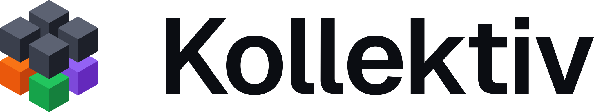

<picture>
  <source media="(prefers-color-scheme: dark)" srcset="https://raw.githubusercontent.com/kollektiv-mc/.github/main/profile/lockup-on-dark.svg">
  
</picture>

Tools for Minecraft servers.

| Repository | What it is | Status |
|---|---|---|
| [Konnekt](https://github.com/kollektiv-mc/Konnekt) | A desktop dashboard for Minecraft servers you host yourself | Alpha, [builds](https://github.com/kollektiv-mc/Konnekt/releases) for Windows and Linux |
| [Kommands](https://github.com/kollektiv-mc/Kommands) | A command generator for Java Edition 1.21.1 | In development, [snapshot builds](https://github.com/kollektiv-mc/Kommands/releases) for Windows and Linux |
| [Kube](https://github.com/kollektiv-mc/Kube) | A visual builder for KubeJS | Not started |

[Kollektiv](https://github.com/kollektiv-mc/Kollektiv) holds what the products share: design tokens, conventions and agent tooling.
